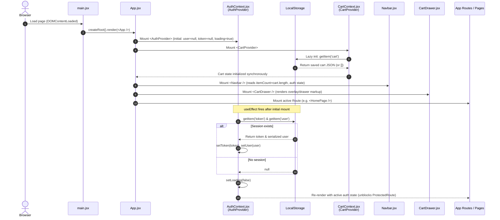
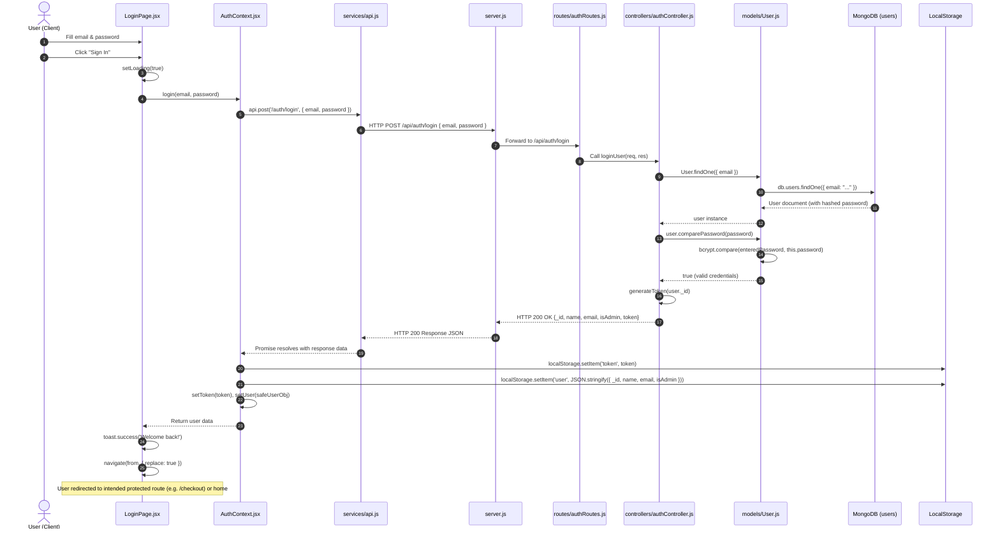
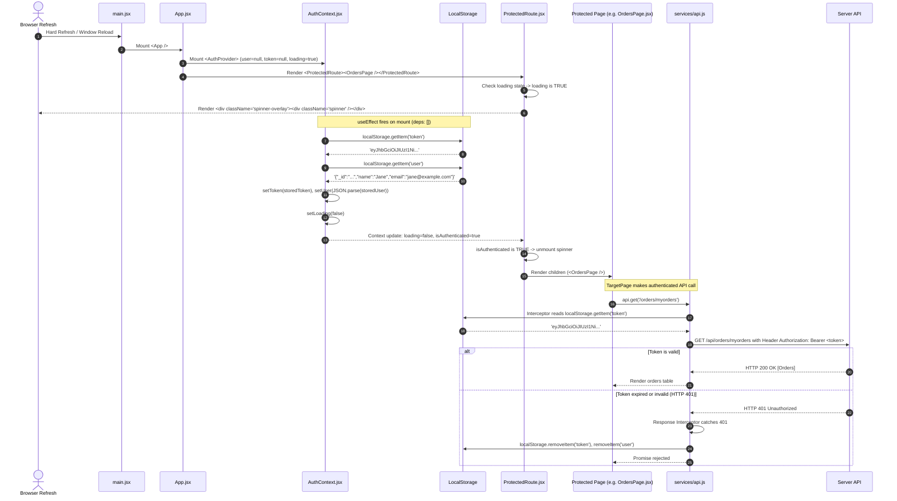
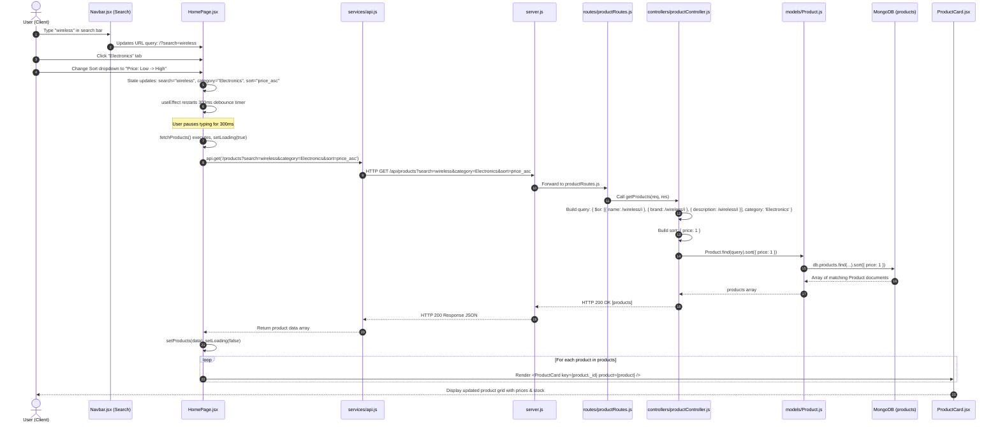
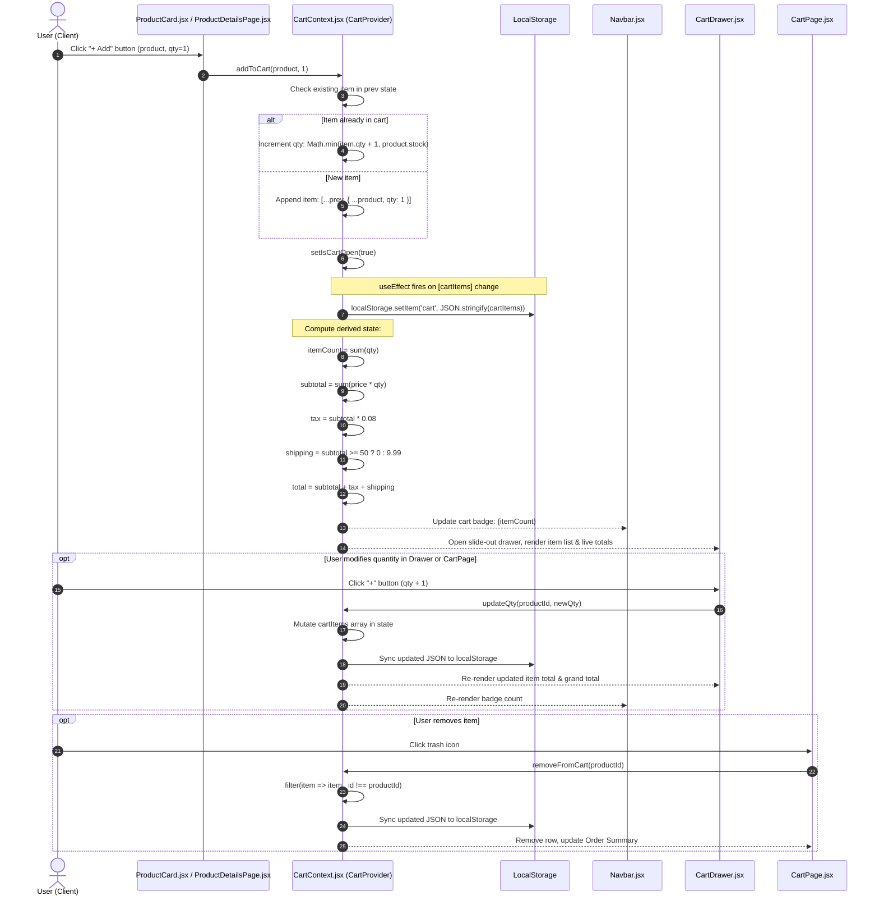
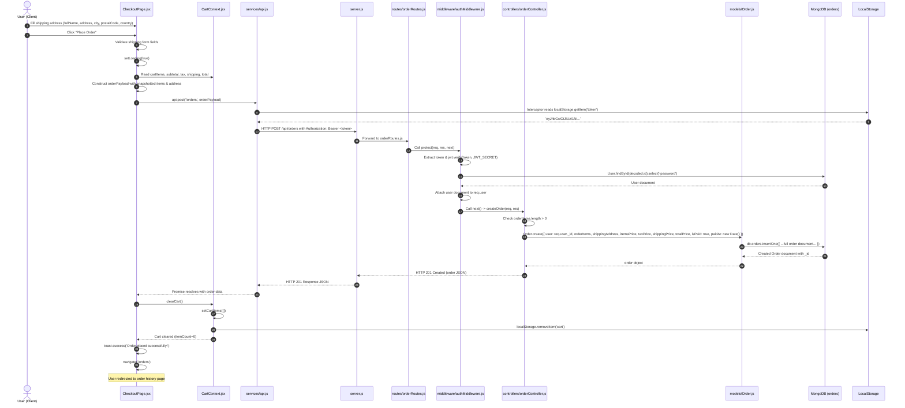
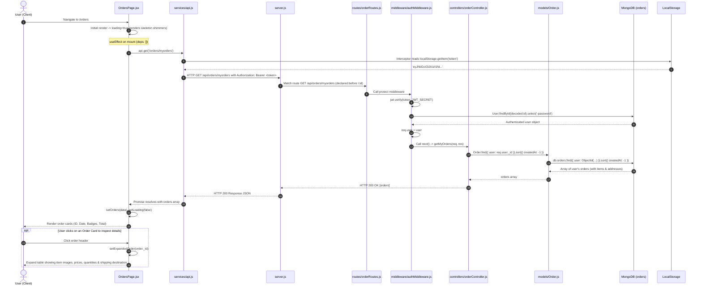
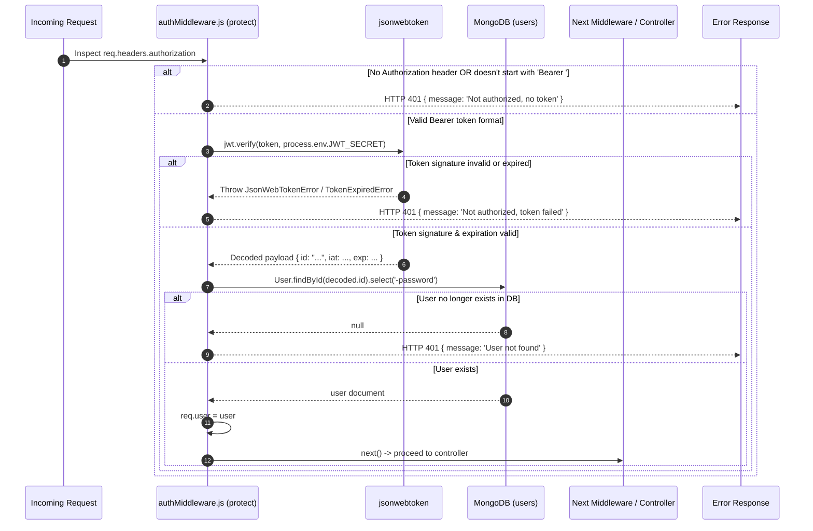
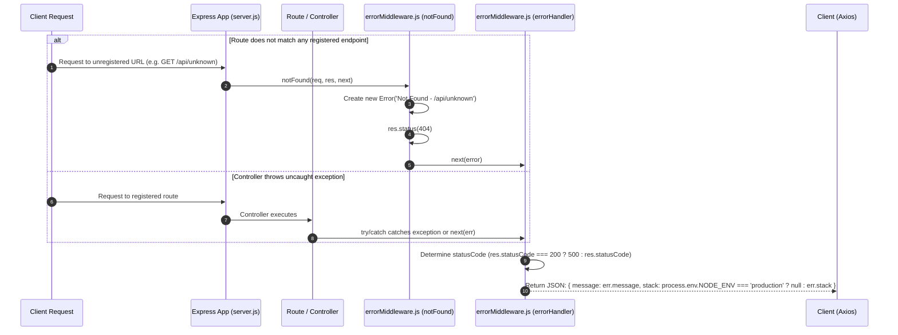
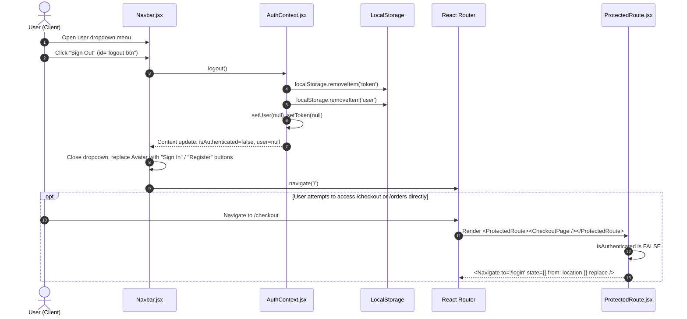

# NovaShop -- Complete Data Flow & Execution Guide

> **Stack:** React 18 (Vite) + Context API | Axios | Express.js | Mongoose | MongoDB | jsonwebtoken | bcryptjs
>
> **Client root:** `client/src/`   **Server root:** `server/`
>
> This document traces every byte of data from the user's click to MongoDB and back.
> Every file path, variable name, function signature, and MongoDB query matches the actual source code.

---

## Table of Contents

1. [Application Bootstrap & Provider Tree](#0-application-bootstrap--provider-tree)
2. [Feature 1 -- User Registration](#feature-1--user-registration)
3. [Feature 2 -- User Login](#feature-2--user-login)
4. [Feature 3 -- Session Persistence on Page Refresh](#feature-3--session-persistence-on-page-refresh)
5. [Feature 4 -- Product Catalog, Search & Filtering](#feature-4--product-catalog-search--filtering)
6. [Feature 5 -- Cart Management & Quantity Updates](#feature-5--cart-management--quantity-updates)
7. [Feature 6 -- Checkout & Order Creation](#feature-6--checkout--order-creation)
8. [Feature 7 -- Order History Retrieval](#feature-7--order-history-retrieval)
9. [Cross-Cutting Concerns & Middleware](#cross-cutting-concerns--middleware)
10. [Complete File Inventory](#complete-file-inventory)

---

## 0. Application Bootstrap & Provider Tree

### Architectural Overview

```
main.jsx --> App.jsx --> context/AuthContext.jsx   (AuthProvider)
                    --> context/CartContext.jsx   (CartProvider)
                    --> components/Navbar.jsx
                    --> components/CartDrawer.jsx
                    --> pages/* (via React Router <Routes>)
```

### Sequence Diagram



### Execution Details:
1. **`main.jsx`** -- Entry point. Calls `createRoot(document.getElementById('root')).render(<StrictMode><App /></StrictMode>)`. Imports `index.css` for the global design system.
2. **`App.jsx`** -- Sets up the component hierarchy:
   - `<BrowserRouter>` at root for client-side routing.
   - `<AuthProvider>` (from `AuthContext.jsx`) -- any descendant can call `useAuth()`.
   - `<CartProvider>` (from `CartContext.jsx`) -- nested inside `AuthProvider`.
   - `<Navbar />` and `<CartDrawer />` rendered OUTSIDE `<Routes>` -- persist across all page navigations.
   - `<Toaster />` from `react-hot-toast` -- global toast notification portal.
   - `<Routes>` -- `/checkout` and `/orders` wrapped in `<ProtectedRoute>`.
3. **`AuthContext.jsx` -- Mount `useEffect` (deps: `[]`)**:
   - Reads `localStorage.getItem('token')` and `localStorage.getItem('user')`.
   - If found: `setToken(storedToken)` and `setUser(JSON.parse(storedUser))`.
   - Always: `setLoading(false)` -- unblocks `ProtectedRoute` from showing a spinner.
4. **`CartContext.jsx` -- Lazy `useState` Initializer**:
   ```js
   const [cartItems, setCartItems] = useState(() => {
     try {
       const saved = localStorage.getItem('cart');
       return saved ? JSON.parse(saved) : [];
     } catch { return []; }
   });
   ```
   Cart items are restored synchronously before initial render, preventing cart badge flickers.

---

## Feature 1 -- User Registration

### Execution File Chain
```
RegisterPage.jsx
  --> AuthContext.jsx register()
        --> api.js (request interceptor fires, no token in localStorage)
              --> [Network: POST http://localhost:5000/api/auth/register]
                    --> server.js (express.json() parses body --> req.body)
                          --> authRoutes.js router.post('/register', registerUser)
                                --> authController.js registerUser()
                                      --> User.js User.create() triggers pre('save') bcrypt hook
                                            --> [MongoDB: db.users.insertOne({ hashed password })]
                                                  --> authController.js res.status(201).json({...token})
                                                        --> AuthContext.jsx _persistSession(data)
                                                              --> RegisterPage.jsx navigate('/')
```

### Sequence Diagram

```mermaid
sequenceDiagram
    autonumber
    actor User as User (Client)
    participant Page as RegisterPage.jsx
    participant AuthCtx as AuthContext.jsx
    participant Axios as services/api.js
    participant Server as server.js
    participant Router as routes/authRoutes.js
    participant Controller as controllers/authController.js
    participant UserModel as models/User.js
    participant DB as MongoDB (users)
    participant LocalStorage as LocalStorage

    User->>Page: Fill form (name, email, password, confirmPassword)
    User->>Page: Click "Create Account"
    Page->>Page: Validate inputs (length >= 6, passwords match)
    Page->>Page: setLoading(true)
    Page->>AuthCtx: register(name, email, password)
    AuthCtx->>Axios: api.post('/auth/register', { name, email, password })
    Axios->>Axios: Request Interceptor (token is null -> no Authorization header)
    Axios->>Server: HTTP POST /api/auth/register (JSON payload)
    Server->>Server: express.json() parses payload into req.body
    Server->>Router: Forward to /api/auth route handler
    Router->>Controller: Call registerUser(req, res)
    
    Controller->>UserModel: User.findOne({ email })
    UserModel->>DB: db.users.findOne({ email: "..." })
    DB-->>UserModel: null (email not taken)
    UserModel-->>Controller: null
    
    Controller->>UserModel: User.create({ name, email, password })
    UserModel->>UserModel: pre('save') hook: bcrypt.genSalt(10) + bcrypt.hash(password)
    UserModel->>DB: db.users.insertOne({ name, email, password: <hash>, isAdmin: false })
    DB-->>UserModel: Saved User Document with _id
    UserModel-->>Controller: user object
    
    Controller->>Controller: generateToken(user._id) -> jwt.sign({ id }, JWT_SECRET, { expiresIn: '30d' })
    Controller-->>Server: HTTP 201 Created {_id, name, email, isAdmin, token}
    Server-->>Axios: HTTP 201 Response JSON
    Axios-->>AuthCtx: Promise resolves with response data
    
    AuthCtx->>LocalStorage: localStorage.setItem('token', token)
    AuthCtx->>LocalStorage: localStorage.setItem('user', JSON.stringify({ _id, name, email, isAdmin }))
    AuthCtx->>AuthCtx: setToken(token), setUser(safeUserObj)
    AuthCtx-->>Page: Return user data
    
    Page->>Page: toast.success('Welcome to NovaShop!')
    Page->>Page: navigate('/')
    Note over Page,AuthCtx: Navbar re-renders showing user avatar; HomePage mounts
```

### Breakdown by Lifecycle Layer:

#### 1. Client Action & State (`RegisterPage.jsx`)
- **Trigger:** Form submit with name, email, password, confirm password.
- **Validation:** Minimum 6 characters, passwords match check.
- **Dispatch:** Calls `register()` in `AuthContext`.

#### 2. Network & API Interception (`api.js`)
- Request interceptor checks `localStorage.getItem('token')`. Since none exists, skips `Authorization` header.
- Axios dispatches `POST http://localhost:5000/api/auth/register`.

#### 3. Server Routing & Middleware (`server.js` -> `authRoutes.js`)
- `express.json()` middleware parses body into `req.body`.
- `authRoutes.js` routes `POST /register` directly to `registerUser` (public access).

#### 4. Controller Logic & DB Interaction (`authController.js` -> `User.js`)
- `User.findOne({ email })` checks for duplicates.
- `User.create(...)` invokes Mongoose schema pre-save hook:
  ```js
  userSchema.pre('save', async function (next) {
    if (!this.isModified('password')) return next();
    const salt = await bcrypt.genSalt(10);
    this.password = await bcrypt.hash(this.password, salt);
    next();
  });
  ```
- Generates JWT: `jwt.sign({ id: user._id }, process.env.JWT_SECRET, { expiresIn: '30d' })`.

#### 5. Response & UI Reconciliation (`AuthContext.jsx` -> `RegisterPage.jsx`)
- `_persistSession(data)` stores `token` and `user` into `localStorage` and React state.
- `isAuthenticated` becomes `true`, Navbar renders user avatar, `navigate('/')` loads `HomePage`.

---

## Feature 2 -- User Login

### Execution File Chain
```
LoginPage.jsx
  --> AuthContext.jsx login()
        --> api.js (POST, no existing token)
              --> authRoutes.js router.post('/login', loginUser)
                    --> authController.js loginUser()
                          --> User.js User.findOne({ email }) + user.comparePassword(password)
                                --> [MongoDB: db.users.findOne({ email })]
                                      --> authController.js res.json({...token}) 200 OK
                                            --> AuthContext.jsx _persistSession(data)
                                                  --> LoginPage.jsx navigate(from, { replace: true })
```

### Sequence Diagram



### Breakdown by Lifecycle Layer:

#### 1. Client Action & State (`LoginPage.jsx`)
- Captures redirection origin: `const from = location.state?.from?.pathname || '/'`.
- Calls `login(form.email, form.password)` from `useAuth()`.

#### 2. Network & Server Routing (`api.js` -> `authRoutes.js`)
- Request dispatched to `POST /api/auth/login`.

#### 3. Controller Logic & DB Interaction (`authController.js` -> `User.js`)
- Fetches user by email: `User.findOne({ email })`.
- Invokes instance method:
  ```js
  userSchema.methods.comparePassword = async function (enteredPassword) {
    return await bcrypt.compare(enteredPassword, this.password);
  };
  ```
- Constant-time verification prevents timing attacks.

#### 4. Response & UI Reconciliation (`LoginPage.jsx`)
- Stores session in `localStorage` and `AuthContext`.
- Navigates back to `from` with `{ replace: true }` avoiding back-button loops.

---

## Feature 3 -- Session Persistence on Page Refresh

### Execution File Chain
```
[Browser Refresh Event]
  --> main.jsx --> App.jsx (AuthProvider mounts with user=null, token=null, loading=true)
        --> AuthContext.jsx useEffect (deps: [])
              --> localStorage.getItem('token') + localStorage.getItem('user')
                    --> [If both found] setToken(storedToken) + setUser(JSON.parse(storedUser))
                          --> setLoading(false)  [Client-side state rehydration]
                                --> ProtectedRoute.jsx: loading=false, isAuthenticated=true --> renders children
```

### Sequence Diagram



### Breakdown by Lifecycle Layer:

#### 1. Initial State & Loading Barrier (`AuthContext.jsx`)
- State initialized: `user: null`, `token: null`, `loading: true`.
- `loading = true` acts as a shield: `ProtectedRoute` displays a spinner rather than redirecting to `/login`.

#### 2. Rehydration from Storage (`AuthContext.jsx`)
- `useEffect` with empty dependencies runs after initial render.
- Reads `token` and `user` from `localStorage`.
- Sets state and flips `loading = false`.

#### 3. Protection Guard Resolution (`ProtectedRoute.jsx`)
- `loading === false` && `isAuthenticated === true` renders protected children.
- If `isAuthenticated === false`, redirects to `/login` with `state: { from: location }`.

#### 4. Automated 401 Eviction (`api.js`)
- Response interceptor automatically purges expired credentials from `localStorage` on 401 HTTP codes.

---

## Feature 4 -- Product Catalog, Search & Filtering

### Execution File Chain
```
HomePage.jsx (user changes search/category/sort state)
  --> useCallback memoizes fetchProducts (deps: [search, category, sort])
        --> useEffect fires (300ms debounce setTimeout)
              --> api.js GET /products?search=...&category=...&sort=...
                    --> server.js --> productRoutes.js router.get('/', getProducts)
                          --> productController.js getProducts()
                                --> Product.find(query).sort(sortOption)
                                      --> [MongoDB: regex + enum filter + sort on products collection]
                                            --> productController.js res.json(products) 200 OK
                                                  --> HomePage.jsx setProducts(data) --> grid re-render
                                                        --> ProductCard.jsx (one per product)
```

### Sequence Diagram



### Breakdown by Lifecycle Layer:

#### 1. Client Action & Debounce (`HomePage.jsx`)
- State: `search`, `category`, `sort`.
- Debounce: 300ms `setTimeout` in `useEffect` prevents server flooding during fast typing.

#### 2. Server Routing (`productRoutes.js`)
- `router.get('/', getProducts)` handles public queries.

#### 3. Controller & MongoDB Execution (`productController.js` -> `Product.js`)
- Constructs multi-field `$or` regex filter with `$options: 'i'`.
- Applies category enum filter: `query.category = category`.
- Sort mapping:
  - `price_asc` -> `{ price: 1 }`
  - `price_desc` -> `{ price: -1 }`
  - `rating` -> `{ rating: -1 }`
  - default -> `{ createdAt: -1 }`

#### 4. Grid Reconciliation (`HomePage.jsx` -> `ProductCard.jsx`)
- Replaces skeleton shimmer cards with `<ProductCard />` components.

---

## Feature 5 -- Cart Management & Quantity Updates

### Execution File Chain
```
ProductCard / ProductDetailsPage / CartPage / CartDrawer (trigger components)
  --> CartContext.jsx (addToCart / updateQty / removeFromCart / clearCart)
        --> setCartItems(functional updater) -- in-memory state mutation
              --> useEffect([cartItems]) --> localStorage.setItem('cart', JSON.stringify(cartItems))
                    --> Derived values recomputed on every render:
                          itemCount, subtotal, tax, shipping, total
                          --> All consumers re-render:
                                CartDrawer.jsx (drawer body + footer)
                                CartPage.jsx (table + order summary)
                                Navbar.jsx (cart badge count)
                                CheckoutPage.jsx (order review panel)
```

### Sequence Diagram



### Breakdown by Lifecycle Layer:

#### 1. In-Memory State Updates (`CartContext.jsx`)
- Uses functional updater `setCartItems(prev => ...)` to avoid stale state bugs.
- Capped to inventory: `Math.min(item.qty + qty, product.stock)`.
- Full product data (image, price, title) snapshotted in memory.

#### 2. LocalStorage Sync (`CartContext.jsx`)
- `useEffect` on `[cartItems]` immediately persists changes to `localStorage['cart']`.

#### 3. Real-Time Calculation Formula
- Tax: `8%` (`subtotal * 0.08`).
- Free shipping threshold: `$50.00` (otherwise flat `$9.99`).
- Total: `subtotal + tax + shipping`.

---

## Feature 6 -- Checkout & Order Creation

### Execution File Chain
```
CheckoutPage.jsx (user submits form --> handlePlaceOrder)
  --> CartContext.jsx (reads cartItems, subtotal, tax, shipping, total)
        --> api.js (POST /orders, request interceptor attaches Authorization: Bearer <token>)
              --> [Network: POST http://localhost:5000/api/orders]
                    --> server.js --> orderRoutes.js router.post('/', protect, createOrder)
                          --> authMiddleware.js protect() -- jwt.verify + User.findById + req.user
                                --> orderController.js createOrder()
                                      --> Order.js Order.create() -- snapshots cartItems, refs User._id
                                            --> [MongoDB: db.orders.insertOne({ user:ObjectId, orderItems:[...] })]
                                                  --> orderController.js res.status(201).json(order)
                                                        --> CheckoutPage.jsx:
                                                              CartContext.clearCart()
                                                              toast.success('Order placed!')
                                                              navigate('/orders')
```

### Sequence Diagram



### Breakdown by Lifecycle Layer:

#### 1. Payload Creation & Price Snapshotting (`CheckoutPage.jsx`)
```js
const orderPayload = {
  orderItems: cartItems.map((item) => ({
    name: item.name,
    qty: item.qty,
    image: item.image,
    price: item.price,     // Frozen historical purchase price
    product: item._id,     // Reference to Product catalog
  })),
  shippingAddress: form,
  paymentMethod: 'Mock Payment',
  itemsPrice: subtotal,
  taxPrice: tax,
  shippingPrice: shipping,
  totalPrice: total,
};
```

#### 2. Route Interception & JWT Verification (`authMiddleware.js`)
- Validates token signature with `JWT_SECRET`.
- Loads user model without password and attaches to `req.user`.

#### 3. MongoDB Persistence (`orderController.js` -> `Order.js`)
- Creates order with `isPaid: true` and `paidAt: new Date()` (mock payment architecture).
- Saves embedded `orderItemSchema` subdocuments to guarantee historical audit integrity.

#### 4. Cart Invalidation & Redirection (`CheckoutPage.jsx`)
- Invokes `clearCart()` to wipe in-memory state and remove `localStorage['cart']`.
- Navigates to `/orders`.

---

## Feature 7 -- Order History Retrieval

### Execution File Chain
```
[User navigates to /orders]
  --> App.jsx <ProtectedRoute> wraps <OrdersPage>
        --> ProtectedRoute.jsx checks isAuthenticated (redirect to /login if false)
              --> OrdersPage.jsx mounts --> useEffect (deps: []) fires immediately
                    --> api.js GET /orders/myorders, Authorization: Bearer <token> attached
                          --> [Network: GET http://localhost:5000/api/orders/myorders]
                                --> server.js --> orderRoutes.js
                                      --> authMiddleware.js protect() verifies JWT --> req.user
                                            --> orderController.js getMyOrders()
                                                  --> Order.find({ user: req.user._id }).sort({ createdAt: -1 })
                                                        --> [MongoDB: db.orders.find({ user: ObjectId })]
                                                              --> orderController.js res.json(orders) 200 OK
                                                                    --> OrdersPage.jsx setOrders(data) --> renders cards
```

### Sequence Diagram



### Breakdown by Lifecycle Layer:

#### 1. Component Mount & Skeleton State (`OrdersPage.jsx`)
- Renders 3x animated shimmer loaders while fetching data.

#### 2. Express Route Precedence (`orderRoutes.js`)
```js
router.get('/myorders', protect, getMyOrders);  // Line 8: Specific route
router.get('/:id', protect, getOrderById);      // Line 9: Parameterized route
```
- Declaring `/myorders` before `/:id` prevents Express from interpreting `myorders` as a MongoDB ObjectId parameter.

#### 3. Database Scoping & Security (`orderController.js`)
- `Order.find({ user: req.user._id })` strictly isolates orders to the requesting user's identity.
- Sorted by `{ createdAt: -1 }` (newest first).

#### 4. UI Rendering & Expansion (`OrdersPage.jsx`)
- Header shows formatted date, uppercase 8-character ID slice, payment/delivery status badges.
- Expandable drawer toggle displays subtotal breakdown and shipping address.

---

## Cross-Cutting Concerns & Middleware

### 1. Authentication Guard Sequence (`authMiddleware.js`)



---

### 2. Global Error Handling Pipeline (`errorMiddleware.js`)



---

### 3. User Logout Lifecycle



---

## Complete File Inventory

| File | Type | Responsibility |
|------|------|---------------|
| `client/src/main.jsx` | React Entry | Mounts `<App>` into DOM `#root` |
| `client/src/App.jsx` | Router Root | Provider tree, route definitions, `ProtectedRoute` wrapping |
| `client/src/index.css` | Global CSS | Design system: CSS variables, animations, glassmorphic UI |
| `client/src/context/AuthContext.jsx` | React Context | Auth state (`user`, `token`, `loading`), register, login, logout, storage sync |
| `client/src/context/CartContext.jsx` | React Context | Cart state, add/remove/update/clear, computed formulas, storage sync |
| `client/src/services/api.js` | Axios Instance | Base URL config, request Bearer interceptor, 401 response interceptor |
| `client/src/components/Navbar.jsx` | UI Component | Logo, search bar, cart badge counter, user avatar/dropdown, logout |
| `client/src/components/CartDrawer.jsx` | UI Component | Slide-out cart drawer: items list, quantity counters, totals, checkout CTA |
| `client/src/components/ProductCard.jsx` | UI Component | Product card thumbnail + quick add-to-cart; click navigates to detail |
| `client/src/components/ProtectedRoute.jsx` | Route Guard | Spinner during session rehydration; redirects unauthenticated users |
| `client/src/pages/HomePage.jsx` | Page | Product catalog: search, category tabs, sort dropdown, debounced API calls |
| `client/src/pages/ProductDetailsPage.jsx` | Page | Single product: image, specs, stock counter, quantity selector, add-to-cart |
| `client/src/pages/CartPage.jsx` | Page | Full-page cart table with quantity controls, remove, order summary |
| `client/src/pages/CheckoutPage.jsx` | Page | Shipping form, mock payment system UI, order creation dispatch |
| `client/src/pages/OrdersPage.jsx` | Page | Authenticated order history: expandable cards with item/address breakdowns |
| `client/src/pages/LoginPage.jsx` | Page | Login form with redirect-after-login (`from` state) support |
| `client/src/pages/RegisterPage.jsx` | Page | Registration form with client-side validation |
| `server/server.js` | Express Entry | Middleware setup, route mounting, error middleware registration |
| `server/config/db.js` | DB Config | Mongoose connection to MongoDB via `MONGO_URI` |
| `server/.env` | Environment | `PORT=5000`, `MONGO_URI`, `JWT_SECRET`, `NODE_ENV=development` |
| `server/routes/authRoutes.js` | Router | `POST /register` (public), `POST /login` (public), `GET /me` (protected) |
| `server/routes/productRoutes.js` | Router | `GET /` (public, query params), `GET /:id` (public) |
| `server/routes/orderRoutes.js` | Router | `POST /` (protected), `GET /myorders` (protected), `GET /:id` (protected) |
| `server/middleware/authMiddleware.js` | Middleware | `protect`: JWT verify + User DB lookup; `admin`: isAdmin guard |
| `server/middleware/errorMiddleware.js` | Middleware | `notFound` (404 generator), `errorHandler` (global JSON error response) |
| `server/controllers/authController.js` | Controller | `registerUser`, `loginUser` (bcrypt compare), `getMe`, `generateToken` (JWT) |
| `server/controllers/productController.js` | Controller | `getProducts` (regex search + category filter + sort), `getProductById` |
| `server/controllers/orderController.js` | Controller | `createOrder` (snapshot + mock pay), `getMyOrders`, `getOrderById` (populate + ownership) |
| `server/models/User.js` | Mongoose Model | Schema: name/email/password/isAdmin; pre-save bcrypt hook; `comparePassword()` |
| `server/models/Product.js` | Mongoose Model | Schema: name/desc/price/category(enum)/brand/stock/rating/numReviews/image |
| `server/models/Order.js` | Mongoose Model | Schema: user ref, embedded `orderItems` (price snapshot), shippingAddress, pricing |
| `server/seed.js` | Seed Script | Standalone seed script to populate MongoDB products collection |

---

*Generated by complete static analysis of the NovaShop MERN codebase.*
*Every file path, variable name, function signature, and MongoDB operation matches the actual source code.*
